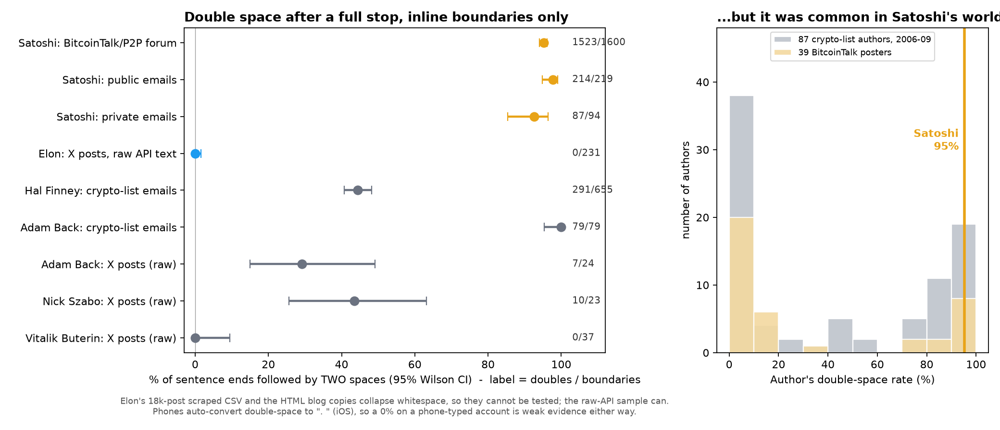
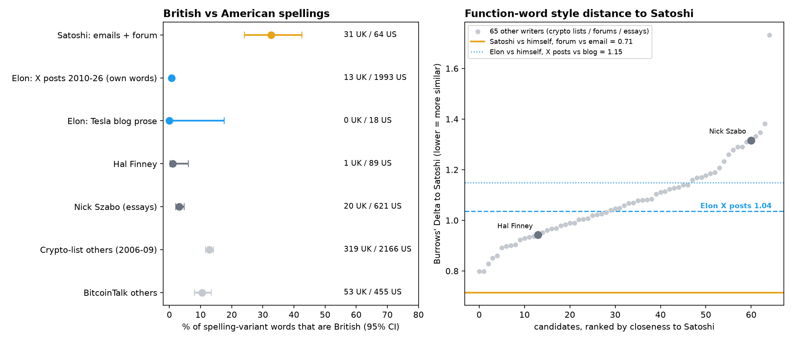
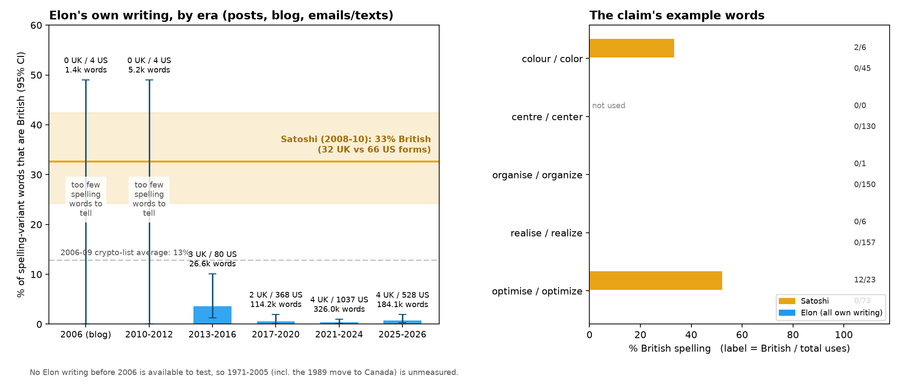

# Is the prose of Satoshi Nakamoto the prose of Elon Musk? A small, honest stylometry test

This repo tests two "writing fingerprints" often cited in the theory that Elon Musk is Satoshi Nakamoto, and one claim added on top:

1. **Double space after a full stop** (typing habit).
2. **British vs American spelling**, including the claim that a South-African-raised Elon *started* with British spelling and *shifted* to American after moving to Canada (1989) and the US ("era shift").
3. **Function-word stylometry** (Burrows' Delta, cosine similarity, character 4-grams) against control writers.

Everything below is produced by the code in `scripts/`; every number can be regenerated. **It reports what supports the theory and what undercuts it.** It cannot prove or disprove who Satoshi is.





## Results at a glance

| Test | Satoshi | Elon | Verdict |
|---|---|---|---|
| Double space after a sentence-ending period (inline boundaries only) | **1,824 / 1,913 = 95.3%** (95% CI 94.3-96.2); forum 95.2%, public emails 97.7%, private emails 92.6% | **0 / 231** in raw-text X posts (CI 0-1.6%), spread over 2012-26 (0/77, 0/88, 0/66 by era). The big 89k-post scrape and the blog copies collapse whitespace, so they *cannot* be tested | Satoshi's habit is real and strong. Elon's raw posts show none. But double-spacing was common in Satoshi's world: 43% of 87 crypto-list authors (2006-09) had a rate >= 50% (Adam Back 79/79; Hal Finney 44%). On a phone, iOS turns double-space into ". " so absence in tweets is only weak evidence |
| British vs American spelling (-our/-or, -ise/-ize, -yse/-yze, -re/-er, -ence/-ense, -ll-/-l-, misc.) | **32 UK vs 66 US = 32.7% British**; only 29 of 605 documents contain any British form; 3 of 30 word-stems appear in *both* variants (optimis/ize 12 vs 11, decentralis/ize 2 vs 7, colo(u)r 2 vs 4) | **13 UK vs 1,993 US = 0.65% British** in 89,485 posts (own words, quoted posts removed, capitalised proper nouns such as "Labour Party" removed); blog prose 0/18; X-API sample 1/24 | Satoshi is *mixed*, not "consistently British". Elon is overwhelmingly American. A mixed ~33% is higher than the 2006-09 crypto-list average (12.8%) and BitcoinTalk average (10.4%) - mildly distinctive - and Elon sits far outside it |
| Era shift (Elon British to American?) | n/a | 2006 blog: 0 UK / 4 US; 2010-12: 0 / 4; 2013-16: 3 / 80 (3.6%, CI 1.2-10%); 2017-20: 2 / 368; 2021-24: 4 / 1,037; 2025-26: 4 / 528 | No shift visible: the earliest testable writing is already American. Before 2013 there are too few spelling words (8) to say anything, and **there is no accessible Elon writing before 2006**, so the 1989 move is untestable. The claim that Elon's early writing was British is *unsupported by data* |
| Function words (150 MFW), Delta to Satoshi, 65 candidate writers | - | Elon X posts: Delta 1.036 (rank 30 of 66 incl. Elon; median writer 1.059); cosine 0.027 | Elon is no closer to Satoshi than a random 2006-09 crypto-list or forum writer. Hal Finney (0.942, 14th of 65) is closer than Elon; Szabo (1.316) is further |
| Genre yardstick | Satoshi's forum vs his own emails: Delta 0.715 | Elon's tweets vs his own blog prose: 1.150; Adam Back's emails vs his own tweets 1.245 | Tweets vs emails is a huge genre gap (same author scores 1.15-1.58). Delta cannot reach a verdict across that gap |
| Chunk validation (2,000-word chunks, 32 candidate writers) | 27/30 Satoshi chunks correctly attributed (90%) | 40/40 Elon chunks attributed to Elon; none to Satoshi; no Satoshi chunk attributed to Elon | The method works within a genre (84.5% overall, chance 3%), but part of Elon's result is just "tweets look like tweets" |
| Quirks (per 10k words) | `lol` 0, emoji 0, "e-mail" 2.8, "email" 0.5, "I think/believe/guess" 14.7, 2.8% of docs start lowercase | `lol` 4.1, emoji 397, "e-mail" **0**, "email" 1.0, "I think..." 6.4, 0.9% start lowercase | Satoshi wrote "e-mail" (17 vs 3 "email"); Elon never does (0 vs 65). "Bloody": Satoshi 1; Elon 3 in own posts ("Bloody hell, I'm going to have to write a blog" is one) |

The claim words: Elon (all own writing) colour/color **0/45**, centre/center **0/130**, organise/organize **0/150**, realise/realize **0/157** (British / total). Satoshi: colour/color 2/6, realise/realize 0/6, organise/organize 0/1, optimise/optimize 12/23, `whilst` 0 (uses "while" 47 times), `learnt` 0.

## Method

**Corpora** (see `scripts/00_fetch_corpora.sh`; word counts after cleaning)

| Corpus | Source | Size | Whitespace preserved? |
|---|---|---|---|
| Satoshi emails (public, 39) + private emails (22) | [Satoshi Nakamoto Institute repo](https://github.com/NakamotoInstitute/nakamotoinstitute.org) JSON; [lugaxker/nakamoto-archive](https://github.com/lugaxker/nakamoto-archive) | 10.8k words | yes (raw plain text; `&nbsp;` markers decoded as the second space) |
| Satoshi forum posts (543: BitcoinTalk / P2P Foundation) | same SNI repo | 51.2k words | yes (`&nbsp;` markers = two spaces) |
| Satoshi white paper | `bitcoin.pdf` via pdftotext | 3.4k words | **no** (PDF) - excluded from the double-space test |
| Elon X posts, 2010-26, non-retweets, own words only (89,485) | [cmj/elontweets](https://github.com/cmj/elontweets) CSV; the quoted-post text appended after `[@handle]` is removed | 646k words | **no** (collapsed) - used for spelling/Delta, not double space |
| Elon X posts, raw API sample (872, stratified 2012-26) | X API v2, whitespace verified (other people's posts in the same API do show double spaces) | 10.5k words | **yes** - used for the double-space test |
| Elon blog prose (5 Tesla posts 2006-16) | [elonmuskarchive.org](https://elonmuskarchive.org/blog) copies | 5.7k words | no (HTML) |
| Elon emails/texts released in court + company emails (48 Elon-authored entries 2010-26) | excerpts on [elonmuskarchive.org/emails](https://elonmuskarchive.org/emails) | 5.5k words | no |
| Controls | [Metzdowd cryptography list 2006-09](https://www.metzdowd.com/pipermail/cryptography/) (6,339 posts, 87 authors with >=50 sentence boundaries), SNI forum posts by other BitcoinTalk users (3,302), library essays by Szabo / Finney / Dai / Back etc., X API samples of Adam Back, Nick Szabo and Vitalik Buterin (208 posts) | 1.7M words (9,821 docs) | mostly yes |

Interview transcripts were **not** used for spelling: the spelling in a transcript is the transcriber's, not the speaker's.

**1. Double space.** Count sentence boundaries *inside a line* (`.`, `!`, `?` + optional quote/bracket + spaces + capital/digit), excluding abbreviations, initials, list numerals and a.m./p.m. Boundaries at a line break are invisible (hard-wrapped emails, tweet line breaks) and are not counted. Rate = boundaries followed by 2+ spaces / all inline boundaries, with Wilson 95% CIs.

**2. Spelling.** 833 British/American pairs with their inflections (-our/-or, -ise/-ize incl. -isation, -yse/-yze, -re/-er, -ence/-ense, -ogue/-og, doubled l, misc.). `analyses` is excluded because it is also the American plural. Capitalised mid-sentence hits (Labour Party, Department of Defence) are skipped. URLs and @mentions are removed first. All hit contexts with their source URLs are in `results/spelling_hits.tsv`.

**3. Delta.** The 150 most frequent function words (from a fixed function-word list) across 65 candidate writers (everyone with >= 4,500 words: crypto-list authors, forum posters, Szabo, Finney, Back, Dai...). Frequencies are z-scored across candidates; Burrows' Delta is the mean absolute z difference to "Satoshi (emails+forum)"; also cosine on z-scores and cosine on the 1,500 most common character 4-grams (whitespace normalised so the double-space habit is not double counted). Validation: leave-one-chunk-out closed-set attribution on 2,000-word chunks. Baselines: same-author cross-genre pairs.

**4. Era shift.** Elon's own writing grouped by year of writing; per-era British share with Wilson CIs, plus the specific words colour/center/organise/realise/optimise/whilst.

## Reproduce

```bash
pip install -r requirements.txt      # + system tools: git, curl, gzip, poppler-utils
export X_BEARER_TOKEN=...            # only for the raw-text X posts; never commit it
bash run_all.sh                      # fetch -> build corpora -> analyses -> charts
```

Outputs land in `results/` (CSV/JSON) and `charts/`. The Satoshi corpus (`data/corpus/satoshi.jsonl`) is included because the texts are public. Tweets are **not** redistributed: `data/ids/` has the post IDs and `scripts/x_fetch_posts.py` re-hydrates them. Control writers' mailing-list posts are re-downloaded from the public Metzdowd archive. (The 89k-post scrape is re-downloaded from its public repo; its ID list is in `data/ids/elon_cmj_scrape_ids.txt`.)

## Caveats - read these before quoting any number

- **Genre mismatch.** Satoshi = emails and forum posts about code and money; Elon = tweets, replies, blog prose. Function-word similarity across that gap is weak evidence either way. The chart-2 yardstick lines show same-author cross-genre distances are as large as Satoshi-vs-Elon.
- **Whitespace fidelity.** Only the raw X API sample can test Elon's double spacing (231 inline boundaries; small). It is a stratified sample, not all posts. Many tweets are single sentences. iOS auto-converts double-space to a period, so a phone user can't easily produce the habit. The Satoshi side is read from JSON/markdown conversions where `&nbsp;` markers represent the extra space; the white paper PDF can't be tested.
- **Double spacing is common** among Satoshi's peers (older typists taught on typewriters): matching it is weak evidence; *failing* to match it in a different medium is also weak.
- **Small numbers.** Satoshi has 98 British/American spelling words in total (only 29 of 605 documents have a British one, and several come from the same posts, e.g. the SHA-256 "optimisation" threads), and Elon has just 8 before 2013. Wilson CIs treat words as independent, which understates uncertainty.
- **Elon's 13 British forms** (in 646k words) are a *ceiling*, not a habit: 4 are "cancelled" and 2 "acknowledgement" (both also standard American variants), 2 are "Labour" (the political party, which slipped through the proper-noun filter), 2 "labelling", and one each of subsidised (a quoted headline), aluminium, humour (a self-correction, "*humour"), and theatre. Full list with URLs: `results/spelling_hits.tsv`.
- **No Elon writing before 2006 is accessible**, so claims about his 1970s-90s spelling (South African English, the 1989 move) are not tested here. A "Grok chat" claim of that shape is unverified by this data: his earliest testable writing is American, and Satoshi's spelling is mixed rather than consistently British.
- Controls are 2006-09 crypto/cypherpunk mailing-list writers and BitcoinTalk posters (many Americans/Europeans); spelling base rates (10-13% British) depend on that population.
- This is a hobby-scale analysis, not forensic linguistics. It does not touch the non-stylometric arguments (timeline, skills, silence).

## Layout

```
scripts/   00_fetch_corpora.sh  x_fetch_posts.py  01_build_corpora.py  02_double_space.py  03_spelling.py
           04_delta.py  05_quirks.py  06_charts.py  07_era_shift.py  spelling_lists.py  common.py
data/ids/        post IDs (tweets are not redistributed)
data/corpus/     satoshi.jsonl (public Satoshi texts)
results/         every table behind every number above
charts/          chart1_double_space.png  chart2_spelling_and_delta.png  chart3_era_shift.png
```

## Sources

- Satoshi Nakamoto Institute: <https://satoshi.nakamotoinstitute.org/> (repo: <https://github.com/NakamotoInstitute/nakamotoinstitute.org>, AGPL-3.0)
- Nakamoto Archive: <https://github.com/lugaxker/nakamoto-archive>
- Metzdowd cryptography list archive: <https://www.metzdowd.com/pipermail/cryptography/>
- Elon X posts scrape: <https://github.com/cmj/elontweets>
- Elon Musk Archive (blog/emails): <https://elonmuskarchive.org/>
- Bitcoin white paper: <https://bitcoin.org/bitcoin.pdf>

Code: MIT (see `LICENSE`). Satoshi texts are public writings; the SNI repository they were read from is AGPL-3.0.
